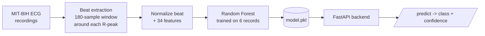
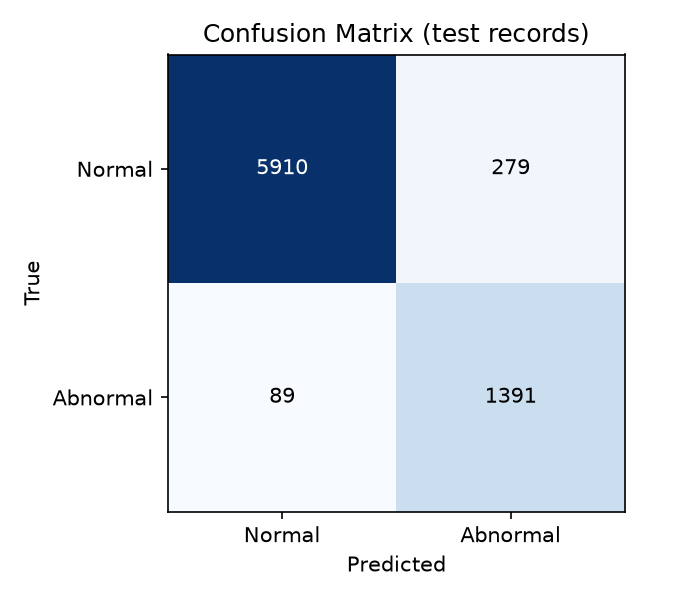

<div align="center">

# ECG Rhythm Classification

**Machine-learning heartbeat classifier with a REST API, trained on real MIT-BIH ECG recordings.**


</div>

---

## What is this?

Doctors check ECGs for dangerous heart-rhythm abnormalities, but reviewing thousands of heartbeats by hand is slow and tiring. This project trains a model that looks at each heartbeat and labels it **Normal** or **Abnormal**, then exposes that model through a small web API anyone can call.

It was built for a combined **AI/ML + Software Engineering** course. It is a **small-scale prototype**, and the sections below are explicit about what it does and does not do.

> **Not a medical device.** This is an academic proof-of-concept and must not be used for diagnosis or treatment.

## Results at a glance

Tested on **7,669 heartbeats from 3 patient recordings the model never saw during training.**

| Metric | Value |
|---|---|
| **Accuracy** | **95.2%** |
| **Abnormal recall** (abnormal beats caught) | **94.0%** (1,391 of 1,480) |
| **Abnormal precision** (alerts that were right) | **83.3%** (279 false alarms) |
| Abnormal F1-score | 0.883 |

<p align="center">
  
</p>

In plain terms: the model catches most abnormal beats, at the cost of some false alarms, which is the preferred trade-off for a screening-assist tool.

## How it works



1. **Data:** real ECG recordings and cardiologist beat labels from the MIT-BIH Arrhythmia Database, downloaded automatically with `wfdb`.
2. **Features (34 per beat):** 4 rhythm features (previous and next RR interval, plus each relative to the local average) and 30 samples of the normalized beat waveform.
3. **Model:** Random Forest (100 trees, balanced class weights) predicting Normal vs Abnormal.
4. **Backend:** a FastAPI service loads the saved model and returns a class and confidence score.

## Try it

**Requirements:** Python 3.9+ and an internet connection (records are downloaded from PhysioNet).

```bash
git clone https://github.com/rktm0604/ecg-rhythm-classification.git
cd ecg-rhythm-classification
pip install -r requirements.txt

python train.py          # trains the model and prints the metrics
uvicorn api:app          # starts the API
```

Then open **http://127.0.0.1:8000/docs** for an interactive page where you can:

1. Call **GET /sample** to get a real normal and a real abnormal beat from the test records.
2. Paste one into **POST /predict** and see the model's answer.
3. Call **GET /metrics** to see the saved evaluation report.

### API

| Method | Endpoint | What it does |
|---|---|---|
| GET | `/` | Health check; reports the expected feature count (34) |
| POST | `/predict` | Send `{"features": [34 numbers]}`, receive `{"class": "Normal" or "Abnormal", "confidence": 0-1}` |
| GET | `/metrics` | Saved test-set evaluation report |
| GET | `/sample` | Real example beats to try with `/predict` |

The API returns a clear error (HTTP 400) if the number of features is wrong.

## Dataset and train/test split

**Dataset:** [MIT-BIH Arrhythmia Database](https://physionet.org/content/mitdb/) (PhysioNet): 48 half-hour, two-channel recordings from 47 subjects at 360 Hz, annotated beat by beat by cardiologists.

**The split is by patient recording, not by beat.** Beats from one recording never appear in both sets. A random beat-level split would let the model "recognize" a patient it already saw, which makes results look better than they really are.

<p align="center">
  
</p>

| Set | Records | Beats | Normal | Abnormal |
|---|---|---|---|---|
| **Train** | 101, 106, 119, 201, 203, 208 | 13,754 | 10,647 | 3,107 |
| **Test** | 200, 210, 221 | 7,669 | 6,189 | 1,480 |

<details>
<summary>Per-record breakdown</summary>

| Split | Record | Beats | Normal | Abnormal |
|---|---|---|---|---|
| Train | 101 | 1,860 | 1,857 | 3 |
| Train | 106 | 2,025 | 1,506 | 519 |
| Train | 119 | 1,984 | 1,540 | 444 |
| Train | 201 | 1,961 | 1,633 | 328 |
| Train | 203 | 2,974 | 2,527 | 447 |
| Train | 208 | 2,950 | 1,584 | 1,366 |
| Test | 200 | 2,598 | 1,741 | 857 |
| Test | 210 | 2,647 | 2,420 | 227 |
| Test | 221 | 2,424 | 2,028 | 396 |

</details>

<details>
<summary>Label mapping (2 classes)</summary>

| Class | MIT-BIH beat symbols |
|---|---|
| Normal | `N`, `L`, `R`, `e`, `j` |
| Abnormal | `A`, `a`, `J`, `S`, `V`, `E`, `F` |

Other symbols (for example paced or unclassifiable beats) are skipped. This groups the AAMI EC57 categories into Normal vs. supraventricular, ventricular and fusion beats; it is not the full 5-class scheme.

</details>

## Detailed results

| Class | Precision | Recall | F1-score | Support |
|---|---|---|---|---|
| Normal | 0.985 | 0.955 | 0.970 | 6,189 |
| Abnormal | 0.833 | 0.940 | 0.883 | 1,480 |
| **Accuracy** | | | **0.952** | 7,669 |
| Macro average | 0.909 | 0.947 | 0.926 | 7,669 |
| Weighted average | 0.956 | 0.952 | 0.953 | 7,669 |

**Confusion matrix** (rows = true class, columns = predicted):

| | Predicted Normal | Predicted Abnormal |
|---|---|---|
| **True Normal** | 5,910 | 279 |
| **True Abnormal** | 89 | 1,391 |

<p align="center">
  
</p>

<details>
<summary>What do these metrics mean?</summary>

| Metric | Meaning |
|---|---|
| Accuracy | Share of all beats classified correctly |
| Precision | Of the beats the model labeled as a class, how many were truly that class |
| Recall | Of the beats truly in a class, how many the model found |
| F1-score | Balance of precision and recall |

Accuracy alone can mislead here because normal beats are the majority, so per-class precision and recall are reported too.

</details>

## Limitations

This is an early prototype, and results should be read with that in mind.

- **Small subset:** 9 of 48 records, with only 3 test records. Different records could change the numbers.
- **One run:** no cross-validation or confidence intervals yet.
- **Two classes only:** the 5 AAMI beat categories are not separated yet.
- **One model:** no comparison with other algorithms yet.
- **Easier setup than real deployment:** it uses the dataset's annotated R-peak positions instead of detecting them automatically, and has no bandpass filtering.
- **No tuning:** no separate validation set or hyperparameter search.
- **One old dataset:** MIT-BIH was recorded in 1975-1979; generalization to other databases is untested.

## Roadmap

- [ ] Use all usable MIT-BIH records and the 5-class AAMI scheme
- [ ] Add SVM and a 1D-CNN and compare all models
- [ ] Bandpass filtering and automatic R-peak detection
- [ ] Validation split, tuning, and cross-validation
- [ ] Compare class-imbalance methods (class weights vs. SMOTE)
- [ ] Unit and integration tests
- [ ] Simple web front end
- [ ] Test on other PhysioNet databases

## Project structure

```
.
├── train.py              # load data, extract features, train, evaluate, save artifacts
├── api.py                # FastAPI backend (/predict, /metrics, /sample)
├── requirements.txt
├── model.pkl             # trained Random Forest (created by train.py)
├── metrics.json          # saved evaluation report (created by train.py)
├── confusion_matrix.png  # created by train.py
├── sample_beats.json     # example beats for the API demo (created by train.py)
├── docs/                 # charts used in this README
├── LICENSE
└── README.md
```

## References

- Moody GB, Mark RG. The impact of the MIT-BIH Arrhythmia Database. *IEEE Engineering in Medicine and Biology Magazine*, 20(3):45-50, 2001.
- Goldberger AL, et al. PhysioBank, PhysioToolkit, and PhysioNet. *Circulation*, 101(23):e215-e220, 2000.
- Dataset: https://physionet.org/content/mitdb/

## License

MIT. See [LICENSE](LICENSE).
