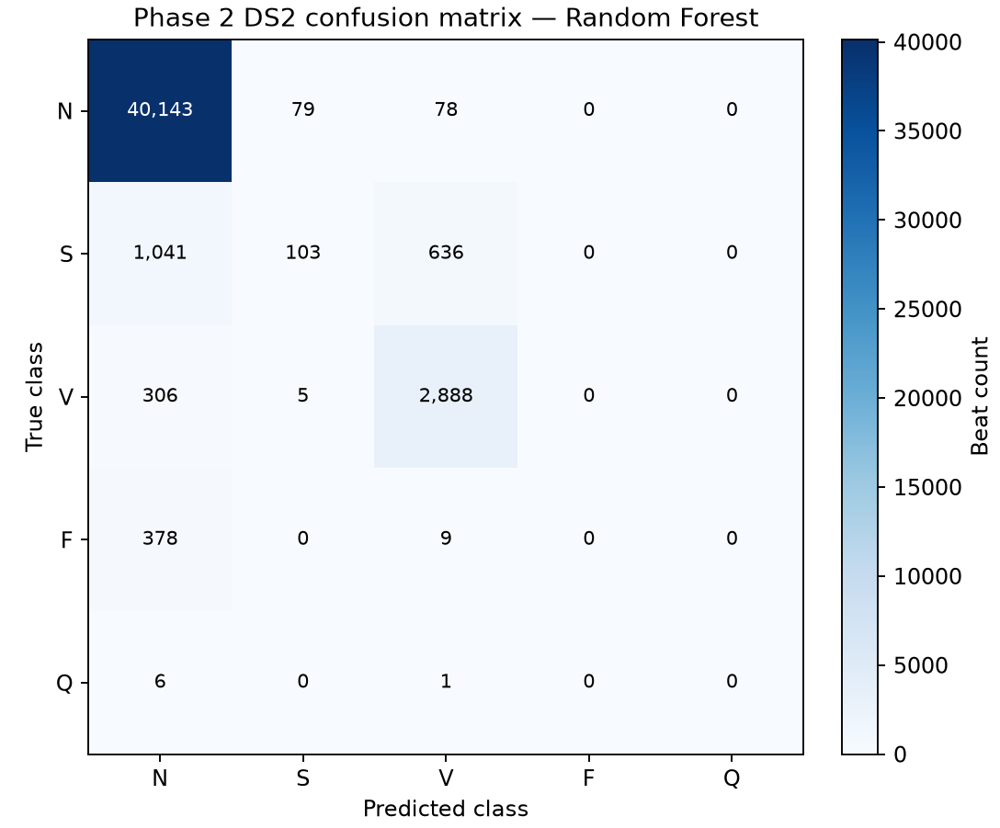
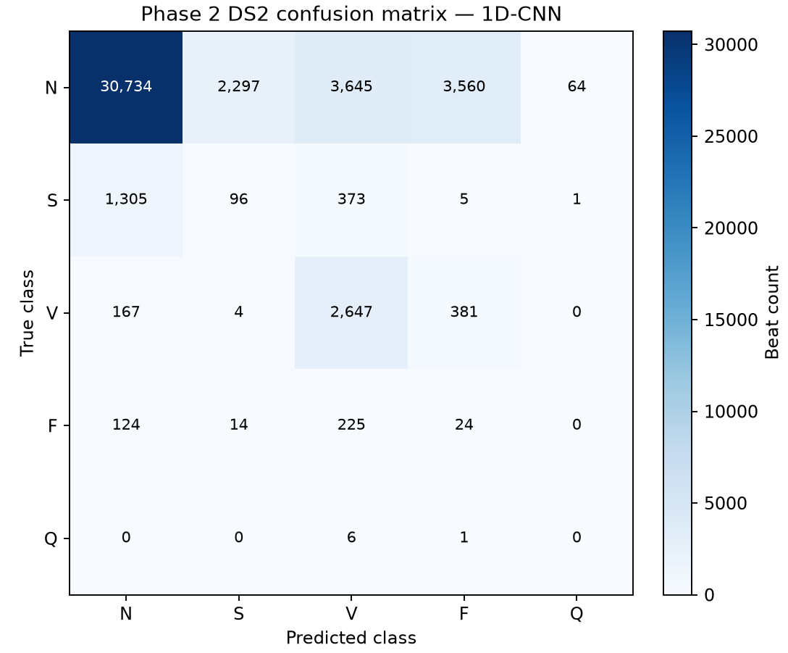
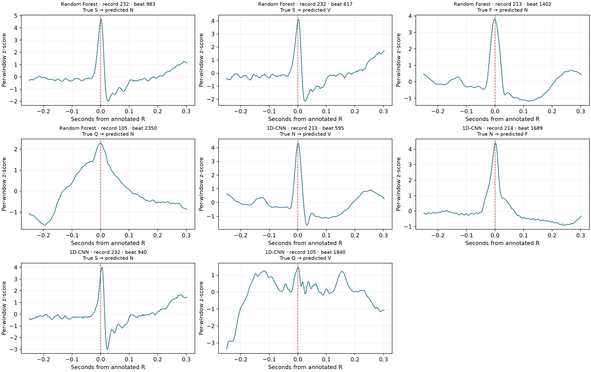
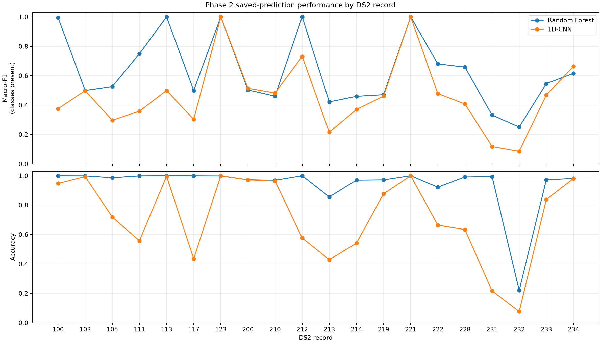

# Phase 2 DS2 Error Analysis

**Experiment:** Phase 2 corrected, five-class, offline/delayed classification
**Primary model:** Random Forest
**Additional comparison:** 1D-CNN
**Evaluation data:** Frozen DS2 predictions; 45,673 beats from 20 records
**Status:** Post-hoc analysis only. No inference, fitting, tuning, or model selection was performed for this analysis.

## Methodology and reproducibility

The analysis reads `artifacts/phase2_corrected/predictions.npz`, `experiment_config.json`, and `results.json`. It recomputes accuracy, macro-F1, one-versus-rest TP/FP/FN/TN, per-class precision/recall/F1/support, confusion matrices, and metrics per record from the saved DS2 labels and predictions. It then checks the recomputed aggregate metrics, class reports, and matrices against the stored `results.json`; the script stops with an error if they disagree.

For waveform examples only, the script reads local MIT-BIH records and calls the shared `pipeline.extract_record_beats`. It maps a saved test row to its record and `beat_number_test`, verifies that the extracted label equals the saved true label, and plots that exact normalized 200-sample window. It does not use a model checkpoint or generate a new prediction. The examples are chosen deterministically as the middle saved row for selected confusion pairs; the data row, record, beat index, and annotated sample are retained in `error_analysis.json`.

Run from the repository root with the existing environment and local MIT-BIH data:

```powershell
python scripts/phase2_error_analysis.py --data-dir data/mitdb
```

In this checkout the local data is outside the repository, so the verified command was:

```powershell
python scripts/phase2_error_analysis.py --data-dir "D:\Downloads\ecg project\data\mitdb"
```

The script writes only to `artifacts/phase2_corrected/error_analysis/`. It has no training or tuning path. Without local raw data it still computes tabular metrics and confusion matrices, but cannot render the ECG windows.

### Generated artifacts

- `error_analysis.json`: complete machine-readable results, including all class-by-record metrics and example metadata.
- `class_metrics_rf.csv`, `class_metrics_cnn.csv`: one-versus-rest metrics.
- `record_metrics_rf.csv`, `record_metrics_cnn.csv`: accuracy, present-class macro-F1, all five class metrics/supports, error counts/rates, and share of all errors.
- `confusion_matrix_rf.csv`, `confusion_matrix_cnn.csv` and matching PNGs.
- `recordwise_performance.png`: per-record accuracy and macro-F1.
- `representative_misclassified_beats.png`: eight saved misclassifications with the annotated R position marked.

## Aggregate confusion matrices and interpretation

Rows are true labels and columns are predicted labels, ordered N, S, V, F, Q.

**Random Forest**

| True \\ predicted | N | S | V | F | Q |
|---|---:|---:|---:|---:|---:|
| N | 40,143 | 79 | 78 | 0 | 0 |
| S | 1,041 | 103 | 636 | 0 | 0 |
| V | 306 | 5 | 2,888 | 0 | 0 |
| F | 378 | 0 | 9 | 0 | 0 |
| Q | 6 | 0 | 1 | 0 | 0 |

**1D-CNN**

| True \\ predicted | N | S | V | F | Q |
|---|---:|---:|---:|---:|---:|
| N | 30,734 | 2,297 | 3,645 | 3,560 | 64 |
| S | 1,305 | 96 | 373 | 5 | 1 |
| V | 167 | 4 | 2,647 | 381 | 0 |
| F | 124 | 14 | 225 | 24 | 0 |
| Q | 0 | 0 | 6 | 1 | 0 |

The RF is much more conservative in assigning minority labels. It correctly recognizes most N and V beats, but misses all F and Q and most S. CNN predicts minority classes much more often: this recovers some F and more V than RF, but creates many false positives and lowers N recall. Both models miss every Q beat.

## Per-class results

TP, FP and FN use a one-versus-rest definition for each class. P/R/F1 are computed from those counts; supports are the true-class counts. These values reproduce the saved Phase 2 results.

| Model | Class | TP | FP | FN | Support | Precision | Recall | F1 |
|---|---|---:|---:|---:|---:|---:|---:|---:|
| RF | N | 40,143 | 1,731 | 157 | 40,300 | 0.9587 | 0.9961 | 0.9770 |
| RF | S | 103 | 84 | 1,677 | 1,780 | 0.5508 | 0.0579 | 0.1047 |
| RF | V | 2,888 | 724 | 311 | 3,199 | 0.7996 | 0.9028 | 0.8480 |
| RF | F | 0 | 0 | 387 | 387 | 0 | 0 | 0 |
| RF | Q | 0 | 0 | 7 | 7 | 0 | 0 | 0 |
| CNN | N | 30,734 | 1,596 | 9,566 | 40,300 | 0.9506 | 0.7626 | 0.8463 |
| CNN | S | 96 | 2,315 | 1,684 | 1,780 | 0.0398 | 0.0539 | 0.0458 |
| CNN | V | 2,647 | 4,249 | 552 | 3,199 | 0.3838 | 0.8274 | 0.5244 |
| CNN | F | 24 | 3,947 | 363 | 387 | 0.0060 | 0.0620 | 0.0110 |
| CNN | Q | 0 | 65 | 7 | 7 | 0 | 0 | 0 |





## Most common classification errors

Ranked off-diagonal counts for RF are **S→N (1,041)**, **S→V (636)**, **F→N (378)**, and **V→N (306)**. For CNN they are **N→V (3,645)**, **N→F (3,560)**, **N→S (2,297)**, **S→N (1,305)**, and **V→F (381)**.

The error patterns differ. RF's dominant weakness is failure to identify S and F; it rarely predicts F or Q at all. CNN recognizes 24 F beats (RF recognizes none) and 2,647 V beats versus RF's 2,888, but its many false positive S/F/V calls result in lower N recall and substantially lower precision for S, V, and F. Overall DS2 RF macro-F1/accuracy is **0.3860/0.9444**, compared with CNN **0.2855/0.7335**. Those aggregate figures conceal very different class errors.

## Representative misclassified beats



The plotted traces are the same per-window z-scored 200-sample inputs from extraction: 90 samples before the annotated R and 110 samples starting at R. Red dashed lines mark the annotated R sample (time zero). They illustrate examples, not class prototypes or explanations of model decisions.

| Model | Record | Eligible beat index | Annotated sample | True → predicted |
|---|---:|---:|---:|---|
| RF | 232 | 983 | 350,902 | S → N |
| RF | 232 | 617 | 221,331 | S → V |
| RF | 213 | 1,402 | 276,505 | F → N |
| RF | 105 | 2,350 | 595,482 | Q → N |
| CNN | 213 | 595 | 116,967 | N → V |
| CNN | 214 | 1,689 | 486,560 | N → F |
| CNN | 232 | 940 | 334,628 | S → N |
| CNN | 105 | 1,840 | 471,893 | Q → V |

Each example is drawn from an actual saved prediction row. The script verifies the saved true label against the corrected extraction row before rendering. The record and sample values are zero-based WFDB sample positions; eligible beat indices are zero-based within the retained rows for that record.

## Record-wise DS2 performance

Macro-F1 below averages only over classes with true support in that record; unsupported classes are not added as zero-F1 terms. Accuracy and macro-F1 are descriptive per-record values, not independent performance estimates. Per-class TP/FP/FN/P/R/F1 and support for every record/class combination are in the two CSV files and JSON. Records often lack most AAMI classes, so per-record class metrics with tiny supports are unstable.

| Record | Beats | RF accuracy | RF macro-F1* | RF errors | CNN accuracy | CNN macro-F1* | CNN errors |
|---:|---:|---:|---:|---:|---:|---:|---:|
| 100 | 2,271 | 0.9996 | 0.9948 | 1 | 0.9472 | 0.3763 | 120 |
| 103 | 2,082 | 0.9990 | 0.4998 | 2 | 0.9942 | 0.4986 | 12 |
| 105 | 2,570 | 0.9864 | 0.5267 | 35 | 0.7183 | 0.2971 | 724 |
| 111 | 2,122 | 0.9991 | 0.7498 | 2 | 0.5575 | 0.3593 | 939 |
| 113 | 1,793 | 1.0000 | 1.0000 | 0 | 0.9961 | 0.4997 | 7 |
| 117 | 1,533 | 0.9993 | 0.5000 | 1 | 0.4351 | 0.3032 | 866 |
| 123 | 1,516 | 0.9987 | 0.9997 | 2 | 1.0000 | 1.0000 | 0 |
| 200 | 2,599 | 0.9723 | 0.5034 | 72 | 0.9719 | 0.5148 | 73 |
| 210 | 2,648 | 0.9690 | 0.4612 | 82 | 0.9637 | 0.4827 | 96 |
| 212 | 2,746 | 1.0000 | 1.0000 | 0 | 0.5765 | 0.7313 | 1,163 |
| 213 | 3,249 | 0.8556 | 0.4224 | 469 | 0.4284 | 0.2157 | 1,857 |
| 214 | 2,260 | 0.9699 | 0.4601 | 68 | 0.5407 | 0.3707 | 1,038 |
| 219 | 2,152 | 0.9717 | 0.4712 | 61 | 0.8769 | 0.4614 | 265 |
| 221 | 2,425 | 1.0000 | 1.0000 | 0 | 0.9996 | 0.9994 | 1 |
| 222 | 2,481 | 0.9218 | 0.6807 | 194 | 0.6638 | 0.4791 | 834 |
| 228 | 2,051 | 0.9917 | 0.6584 | 17 | 0.6329 | 0.4078 | 753 |
| 231 | 1,569 | 0.9943 | 0.3324 | 9 | 0.2167 | 0.1189 | 1,229 |
| 232 | 1,778 | 0.2199 | 0.2516 | 1,387 | 0.0759 | 0.0860 | 1,643 |
| 233 | 3,077 | 0.9721 | 0.5464 | 86 | 0.8378 | 0.4690 | 499 |
| 234 | 2,751 | 0.9815 | 0.6159 | 51 | 0.9807 | 0.6634 | 53 |

\* Macro-F1 over classes present in that record's true labels.



### Records with concentrated errors and small supports

- **Record 232 is the largest RF error contributor:** 1,387/2,539 RF errors (**54.6%**). It contains 1,381 S beats and 397 N beats; S is 77.7% of that record, while the entire DS1 fit split contains 840 S beats. In record 232 RF maps 766 S→N and 615 S→V. This record-level class composition is a concrete distribution difference; the analysis does not establish its cause.
- **RF record 213** contributes 469 errors (**18.5%**), mostly 359 F→N. Together records 232 and 213 account for about 73.1% of RF errors; adding record 222 (194) brings the share to about 80.7%.
- **CNN errors are more distributed.** Records 213 (1,857; 15.3%), 232 (1,643; 13.5%), 231 (1,229; 10.1%), 212 (1,163; 9.6%), and 214 (1,038; 8.5%) contribute about 57.0% combined. Their leading mistakes include N→V/F in 213/214, N→F/V in 231, N→S/V in 212, and S→N/V in 232.
- **Record 231's class-specific scores are especially unstable:** it has only 1 S and 2 V examples. Record 103 has 2 S; 111 has 1 V; 117 has 1 S; 123 has 3 V; record 105 has 5 Q; record 214 has 2 Q and 1 F. A high or low record metric involving such support should not be interpreted as reliable class performance.
- Records with no examples of a class have no within-record recall estimate for that class. The CSV reports support zero and the corresponding one-versus-rest counts; it does not imply that the model was tested on that class in that record.

## Minority-class analysis

- **S:** DS2 has 1,780 S beats. RF precision is 0.5508 but recall only 0.0579 (1,677 missed), predominantly S→N and S→V. CNN recall is similarly low (0.0539) and precision is only 0.0398 because it produces 2,315 false-positive S predictions. Record 232's S-heavy composition is a major source of errors for both.
- **V:** RF is strongest on V (recall 0.9028, F1 0.8480). CNN recall is 0.8274, but its precision is 0.3838 because of 4,249 false-positive V predictions, including 3,645 N→V errors.
- **F:** RF predicts no F examples. CNN correctly predicts 24/387 (recall 0.0620), but has 3,947 false positives, so F precision is 0.0060. Only 31 F examples are in DS1 fit, a severe training-support limitation.
- **Q:** There are only 7 Q examples in DS2 and 4 in DS1 fit. Neither model correctly classifies a Q beat. CNN predicts Q 65 times (all false positives); RF never predicts Q. These numbers cannot support a stable estimate of Q recognition.

The large accuracy/macro-F1 gap is expected under this class distribution: N is 40,300/45,673 (88.2%) of DS2. Accuracy rewards correct N classification heavily, while macro-F1 gives each class equal weight. Neither headline score alone describes performance across classes.

## RF versus CNN: observed differences

RF exceeds CNN by **0.1004 macro-F1** and **0.2109 accuracy** on these same frozen DS2 examples. RF has higher precision and F1 for N, S, and V, and a slightly higher V recall. CNN recalls more V false cases differently and detects 24 F examples, whereas RF detects none; however, CNN F precision is near zero. Neither recognizes Q. CNN's broader minority predictions cause substantially more N→S/V/F errors. This is a descriptive comparison of the saved systems, whose input representations differ (34 engineered features for RF versus 200 waveform samples for CNN); it does not isolate architecture as the reason for the difference.

## Limitations and evidence-based interpretation

1. These are post-hoc associations from one held-out partition. They do not prove why a beat or record was misclassified.
2. A high concentration of errors in record 232 coincides with an unusually high S proportion; this supports investigating record-level distribution and morphology differences, but does not establish a causal mechanism.
3. The report does not assert signal noise, annotation errors, subject effects, or clinical causes. No signal-quality assessment or blinded waveform review was performed.
4. F/Q fit and test supports are small, so their metrics are especially uncertain. Record-level supports are often smaller still.
5. Per-record macro-F1 averages over classes present in the record, so it is not directly the same estimand as the fixed five-class aggregate macro-F1. Both are included with definitions.
6. Examples show normalized windows only. They are useful for checking actual shapes and labels, but are not a systematic qualitative review and cannot explain model behavior.
7. Phase 2 is offline/delayed: annotated beat locations, following-beat RR context, and post-R waveform samples are used. This analysis does not evaluate beat detection or causal-at-R inference.

## Practical recommendations

- Review the DS2 record 232 composition and the 213 F errors with a predefined, blinded waveform/error-review protocol; keep DS2 out of any model changes and use a separate development set for future iterations.
- Collect more independent F and Q examples and report their support and uncertainty explicitly. Do not draw broad conclusions from seven Q test beats.
- If improving minority performance, first design changes and selection rules on DS1 validation (or a new development cohort), then evaluate a frozen model on DS2 only once.
- Add record-stratified and signal-quality analyses only with prespecified definitions; compare errors to class prevalence and record source without presenting associations as causes.
- Retain per-class confusion counts, precision/recall, and class supports beside accuracy and macro-F1 in reports and dashboards.
- Keep Phase 2 offline/delayed and Phase 4 causal results separate because their information cutoffs differ.

