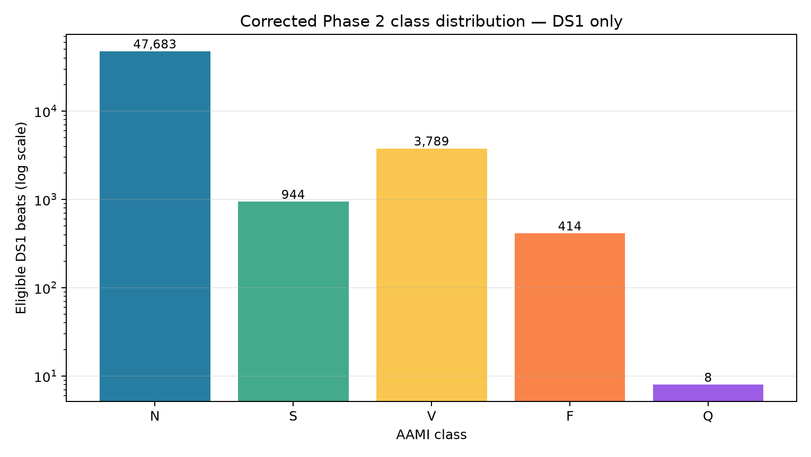
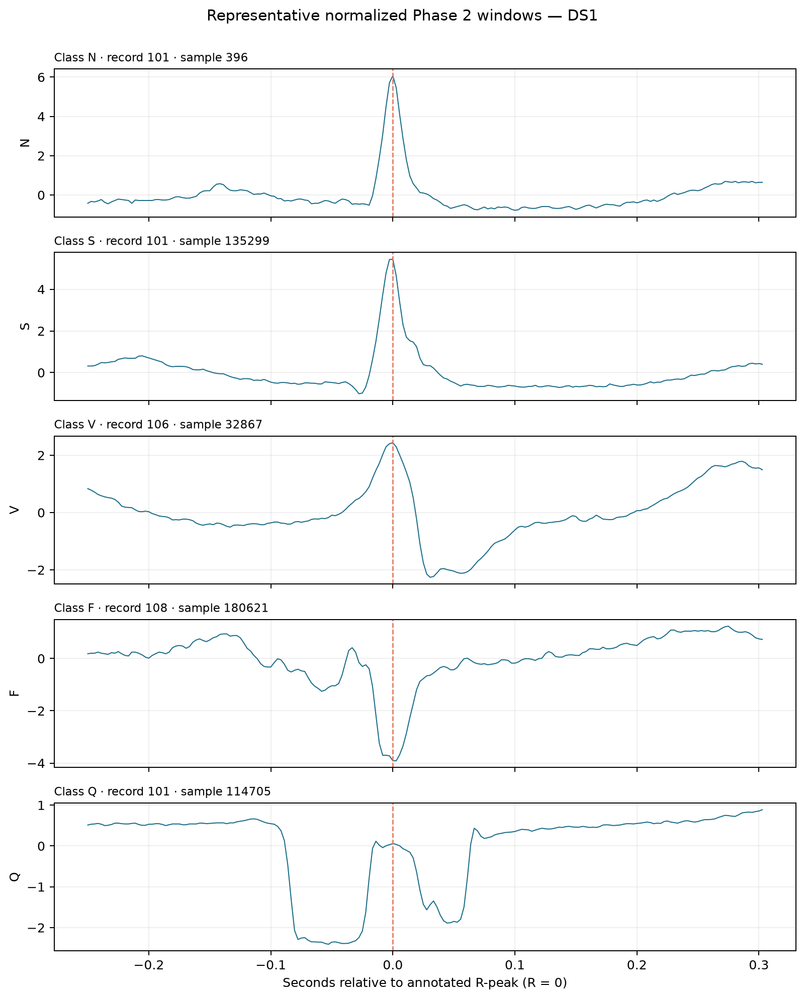
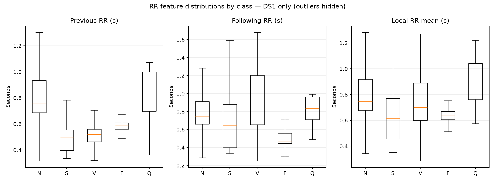
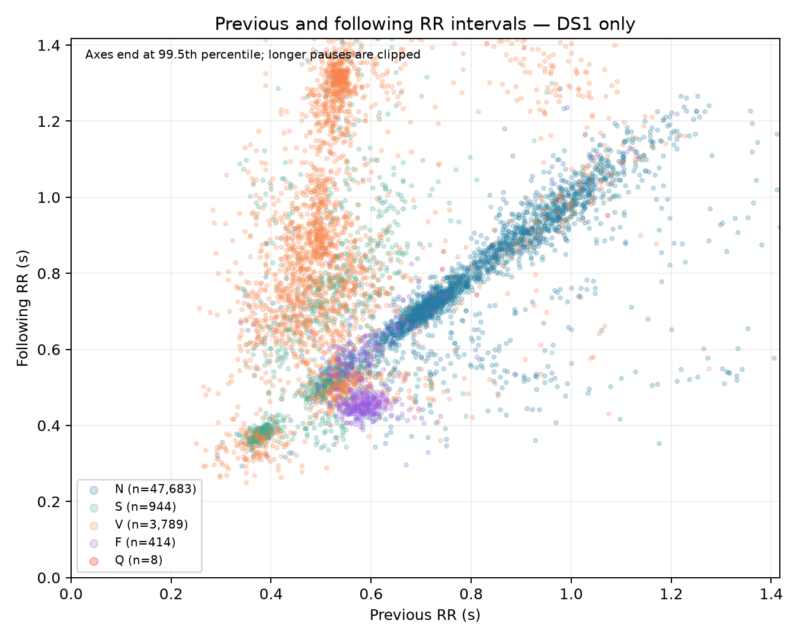
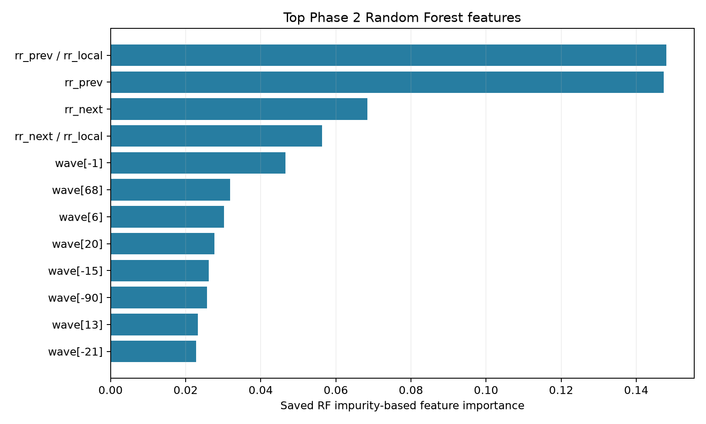

# ECG Rhythm Classification — Phase 2 Final Report

**Primary experiment:** Phase 2 corrected offline/delayed classification
**Primary selected model:** Random Forest, selected by DS1 validation macro-F1
**Additional comparison:** 1D-CNN
**Dataset:** MIT-BIH Arrhythmia Database
**Prediction unit:** an expert-annotated heartbeat; automatic beat detection is outside scope

## Abstract

This project evaluates five-class AAMI heartbeat classification from reference-annotated MIT-BIH beats. The primary Phase 2 experiment is offline/delayed: the Random Forest (RF) uses RR context that includes a following beat and waveform samples after the annotated R-peak; a 1D-CNN is retained as a comparison. Records are separated between DS1 model development and held-out DS2 evaluation. RF achieved DS2 macro-F1 0.3860 and accuracy 0.9444, while the CNN achieved 0.2855 and 0.7335. These accuracy values are dominated by the normal class. RF S recall was 0.0579 and its F and Q recall were zero; the CNN also had zero Q recall. A distinct Phase 4 experiment uses only past RR context and waveform ending at R, so its information cut-off and eligible beat set differ. The results are research findings for annotation-assisted beat classification, not clinical performance claims.

## 1. Problem Statement

This project classifies a known, annotated heartbeat into five AAMI-style groups: N, S, V, F, and Q. The task starts from an annotation-provided beat location and asks for its class. It does not locate R-peaks in a continuous ECG and does not claim clinical use.

The objectives are to implement the approved annotation-assisted extraction, compare RF and CNN under the same record split, report class-sensitive metrics and baselines, and separately document the causal information cut-off. Macro-F1 is the primary selection and comparison metric because it gives each of the five classes equal weight; accuracy remains useful but can be high when the majority N class dominates.

Phase 2 is the primary **offline/delayed** experiment. It uses the approved 200-sample window with 90 samples before and 110 samples from the annotated R-peak onward, plus RR context that includes a following heartbeat. The availability of future waveform and beat timing means the result is not a causal prediction made at the R-peak.

Random Forest is designated the primary selected model because it had the higher DS1 validation macro-F1 (0.3992 versus 0.3717 for the CNN). This model designation uses validation evidence; it does not use DS2 to select the model. The CNN remains a useful secondary architecture comparison.

## 2. Dataset Description

The MIT-BIH Arrhythmia Database contains 48 approximately 30-minute, two-channel ambulatory ECG recordings from 47 subjects, digitized at 360 samples/second, with expert-reviewed reference beat and rhythm annotations. Records 201 and 202 are from the same subject. The repository does not contain the raw database; the PhysioNet dataset and citation are listed in Section 12. The local extraction expects `.hea`, `.dat`, and `.atr` files under `data/mitdb/`.

The corrected extraction retained 98,511 beats across the selected DS1 and DS2 records:

| Class | Total corrected beats | DS1 fit | DS1 validation | DS2 final test |
|---|---:|---:|---:|---:|
| N | 87,983 | 37,966 | 9,717 | 40,300 |
| S | 2,724 | 840 | 104 | 1,780 |
| V | 6,988 | 2,266 | 1,523 | 3,199 |
| F | 801 | 31 | 383 | 387 |
| Q | 15 | 4 | 4 | 7 |
| **Total** | **98,511** | **41,107** | **11,731** | **45,673** |

Counts above are taken from the Phase 2 experiment configuration and results, which the artifact tests cross-check against prediction support. Dataset prevalence is not representative of population prevalence: MIT-BIH intentionally includes recordings selected for uncommon arrhythmias.

The project excludes paced recordings 102, 104, 107, and 217. Record 202 is omitted because it shares a subject with record 201. Record 121 is included in this project's DS1 allocation; the project split should not be described as an exact reproduction of the standard benchmark allocation.

## 3. Data Preparation

`pipeline.py::_read_record` loads local signals and `atr` annotations with WFDB, selecting the MLII channel from its header label where possible and warning before falling back to channel 0. The code assumes 360 Hz (`FS = 360`); the audit can report header frequency, but extraction does not currently reject a record with a different frequency.

The symbol mapping in `pipeline.py::LABEL_MAP` is:

| AAMI class | Mapped symbols |
|---|---|
| N | `N`, `L`, `R`, `e`, `j` |
| S | `A`, `a`, `J`, `S` |
| V | `V`, `E` |
| F | `F` |
| Q | `/`, `f`, `Q` |

Only mapped heartbeat annotations are RR endpoints. Non-beat annotations remain in the annotation arrays and do not become interval endpoints. `extract_record_beats` excludes the first and last mapped beats when the required previous or next beat is unavailable; it also excludes windows crossing a record boundary, non-finite waveform samples, and invalid or nonpositive RR values. Missing local data files raise an explicit `FileNotFoundError`; no raw-signal imputation is done.

Each eligible beat produces a 200-sample window: `signal[R-90:R+110]`, with R at index 90 and array indices through `R+109`. The window is normalized independently with mean and standard deviation (`pipeline.py::_safe_zscore`). No filtering, baseline-wander correction, or resampling is applied. Per-window normalization removes the window's mean and scale; this may reduce sensitivity to absolute amplitude, but the project did not run an ablation to establish whether this improves performance.

The RR features are `rr_prev`, `rr_next`, `rr_prev / rr_local`, and `rr_next / rr_local`. `rr_local` is the mean of up to two preceding and two following intervals between valid heartbeat positions. This future context is intentional for the approved offline/delayed design. Model inputs exclude raw annotation symbols, annotation indices, sample numbers, record IDs, and split labels; annotation symbols supply only the target class and valid heartbeat positions. Record IDs are used for grouped splitting, not as model features.

## 4. Exploratory Data Analysis

EDA was generated from corrected DS1 records only. The EDA script loads no DS2 records and does not fit models or tune the saved model. Counts agree with the DS1 fit plus validation totals in the Phase 2 configuration.



The 52,838 eligible DS1 beats are 90.24% N, 1.79% S, 7.17% V, 0.78% F, and 0.015% Q. There are about 5,960 N beats for each Q beat. The logarithmic axis makes the F and Q counts visible without implying class balance.



The waveform figure shows one deterministically selected eligible example per class from DS1, normalized as used by the pipeline, with the annotated R location at zero. It illustrates that beat morphology varies by class, but a single example per class is not evidence of class-wide separability.



The class-wise RR boxplots show differences in medians and substantial overlap. Median previous RR is 0.761 s for N, 0.494 s for S, 0.519 s for V, 0.586 s for F, and 0.778 s for Q. Q is based on only eight DS1 examples, so its distribution is descriptive only. The boxplots hide individual outliers.



N beats form a dense, near-diagonal previous/following RR pattern; ectopic classes show broader and shifted patterns. The axes clip intervals beyond the 99.5th percentile to keep the central mass legible. This visualization uses the future `rr_next` feature and therefore describes the offline/delayed dataset, not a causal input.



The already-saved DS1-selected Random Forest assigns its largest impurity-based importances to `rr_prev / rr_local` (0.1480), `rr_prev` (0.1473), `rr_next` (0.0684), and `rr_next / rr_local` (0.0563). This is model-specific, impurity-based importance, not a causal explanation or a held-out feature selection result. The script saves all plots and their counts/statistics under `artifacts/phase2_corrected/eda/`.

## 5. ML Methodology

**Primary Random Forest.** `artifacts/phase2_corrected/train_eval_phase2.py::main` fits the RF on 34 values per beat: four engineered RR values and 30 evenly spaced samples from the normalized waveform. It outputs one of the five AAMI labels. The selected saved model has 300 trees, `max_depth=None`, `min_samples_leaf=1`, seed 42, and class weights N=1, S=5, V=1, F=8, Q=1.

**Additional 1D-CNN.** The CNN receives the full window as a tensor with shape `[batch, 1, 200]`. `ECGNet` uses Conv1D blocks with 32 filters/kernel 9, 64/kernel 7, and 128/kernel 5; each block has batch normalization and ReLU, and the first two blocks are followed by max-pooling by 2. Adaptive average pooling, flattening, dropout 0.35, and a linear 128-to-5 layer produce class logits.

The two algorithms use the same Phase 2 fit and validation examples and the same DS2 examples, but their representations differ: the RF receives engineered features and downsampled morphology; the CNN receives the full normalized morphology. Therefore, the comparison is matched by examples and partitions, not by identical input vectors.

## 6. Model Training and Tuning

The stored split is record-wise. DS1 has 23 records; within it, a deterministic `GroupShuffleSplit(test_size=0.20, random_state=42)` assigns 18 records to fitting and 5 to validation. DS2 contains 20 held-out records. Both models and Phase 2 baselines use the same fit/validation records:

- **DS1 fit (18):** 106, 108, 109, 112, 114, 115, 116, 121, 122, 124, 201, 203, 207, 209, 215, 220, 223, 230.
- **DS1 validation (5):** 101, 118, 119, 205, 208.
- **DS2 final evaluation (20):** 100, 103, 105, 111, 113, 117, 123, 200, 210, 212, 213, 214, 219, 221, 222, 228, 231, 232, 233, 234.

Record 202 is excluded because it shares a subject with record 201. Record 121 is included in this project's DS1 allocation, so this is not claimed to be an exact standard benchmark allocation. The exact lists are also saved in `experiment_config.json`.

RF selection evaluates 12 combinations: `max_depth` in `{None, 24}`, `min_samples_leaf` in `{1, 3}`, and three class-weight settings, with 300 trees fixed. The candidate with the highest DS1 validation macro-F1 was selected (0.399237). The bounded grid tests tree depth, leaf regularization, and imbalance weights; it does not establish a global optimum. CNN training is fixed at AdamW, learning rate 0.001, weight decay 0.0001, batch size 256, maximum 35 epochs, and patience 7. It uses weighted cross-entropy with weights calculated from DS1 fit data and early stopping on DS1 validation macro-F1; the saved best epoch is 18 (validation macro-F1 0.371671).

The forest-size, CNN learning-rate, architecture, and optimizer choices were not subjected to a broad search in this phase. The documented selection procedure is reproducible, but the project does not establish that these are optimal hyperparameters. DS2 is used only after choices are frozen for final evaluation.

## 7. Results and Evaluation

Macro-F1 is the primary metric because it gives each class equal weight; accuracy is reported as a secondary metric and is dominated by N. The values below are independently recomputed by `tests/test_phase2_results.py` from saved predictions and agree with `results.json` and the stored confusion matrices.

| Model | DS1 validation macro-F1 | DS1 validation accuracy | DS2 macro-F1 | DS2 accuracy |
|---|---:|---:|---:|---:|
| **Random Forest** | **0.3992** | **0.9558** | **0.3860** | **0.9444** |
| 1D-CNN | 0.3717 | 0.7516 | 0.2855 | 0.7335 |
| Majority baseline | 0.1812 | 0.8283 | 0.1875 | 0.8824 |
| RR-only Logistic Regression | 0.2739 | 0.5017 | 0.2588 | 0.4670 |

DS2 per-class metrics, in class order N, S, V, F, Q:

| Class | Support | RF precision | RF recall | RF F1 | CNN precision | CNN recall | CNN F1 |
|---|---:|---:|---:|---:|---:|---:|---:|
| N | 40,300 | 0.9587 | 0.9961 | 0.9770 | 0.9506 | 0.7626 | 0.8463 |
| S | 1,780 | 0.5508 | 0.0579 | 0.1047 | 0.0398 | 0.0539 | 0.0458 |
| V | 3,199 | 0.7996 | 0.9028 | 0.8480 | 0.3838 | 0.8274 | 0.5244 |
| F | 387 | 0 | 0 | 0 | 0.0060 | 0.0620 | 0.0110 |
| Q | 7 | 0 | 0 | 0 | 0 | 0 | 0 |

DS2 confusion matrices (rows are true class; columns are predicted class; order N, S, V, F, Q):

```text
Random Forest
[[40143,    79,   78,    0, 0],
 [ 1041,   103,  636,    0, 0],
 [  306,     5, 2888,   0, 0],
 [  378,     0,    9,    0, 0],
 [    6,     0,    1,    0, 0]]

1D-CNN
[[30734, 2297, 3645, 3560, 64],
 [ 1305,   96,  373,    5,  1],
 [  167,    4, 2647,  381,  0],
 [  124,   14,  225,   24,  0],
 [    0,    0,    6,    1,  0]]
```

The test suite validates all model metrics, per-class reports, supports, and confusion matrices from `predictions.npz`. It also checks saved checkpoint labels/epochs and verifies saved probability argmax labels against predictions.

## 8. Comparison with Baselines

The available earlier five-class Phase 1 run is the original local `D:\Downloads\ecg project\artifacts\results.json`, produced by `D:\Downloads\ecg project\train_eval.py`. Its script identifies majority-class and RR-only Logistic Regression as baselines and stores a 0.05 macro-F1 improvement margin. The historical Phase 1 DS2 values are:

| Phase 1 baseline | Macro-F1 | Accuracy |
|---|---:|---:|
| Majority baseline | 0.187502 | 0.882374 |
| RR-only Logistic Regression | 0.276034 | 0.485368 |

The Phase 1 saved report records RF macro-F1 0.379382 and an improvement of 0.103347 over its strongest baseline, marking its stored success criterion true. The Phase 2 RF macro-F1 is 0.385958, which is +0.198456 over the historical majority baseline and +0.109924 over the historical RR-only baseline. Both exceed the historical 0.05 margin. The Phase 2 CNN is +0.098010 over Phase 1 majority but only +0.009478 over Phase 1 RR-only, so it does not clear a 0.05 margin over each historical baseline.

These are the actual saved Phase 1 baseline values, not replacements by Phase 2's current baselines. The Phase 1 and Phase 2 DS2 record IDs match, but the saved Phase 1 output contains 45,687 beats while corrected Phase 2 contains 45,673. The corrected eligibility rule removed 14 beats in aggregate (the count difference is 13 N and 1 V); the comparison is therefore record-matched, not exactly beat-matched. The original Phase 1 results and test data are not tracked in the cleaned checkout, so this historical comparison is not fully reproducible from a fresh clone.

For a strictly matched Phase 2 comparison on the corrected examples, RF exceeds the current Phase 2 majority baseline (0.187501) by 0.198458 and the current RR-only baseline (0.258830) by 0.127129 macro-F1. Both current baselines use the same fit, validation, and DS2 rows as RF and CNN. No DS2-based selection was performed.

## 9. Critical Insights and Interpretation

- **Class imbalance drives the accuracy/macro-F1 gap.** N accounts for 40,300 of 45,673 DS2 beats (88.2%). RF accuracy is 94.4% while macro-F1 is 0.3860; high accuracy does not mean reliable minority-class classification.
- **RF favors N and V.** It gets 40,143 N and 2,888 V correct, but misses all 387 F and all 7 Q examples. Its largest error counts are S→N (1,041), S→V (636), and F→N (378).
- **CNN errors are more widely distributed.** It has 12,172 total DS2 errors; large groups are N→V (3,645), N→F (3,560), N→S (2,297), and S→N (1,305). It recalls more V and some F than RF but pays for this with many false-positive minority predictions and lower N recall. Both models miss Q entirely.
- **RR inputs carry strong signal but are not sufficient.** The saved RF's top impurity importances are RR features, and DS1 RR medians differ among N/S/V/F. The distributions overlap, and the Q sample is extremely small. Feature importance is not causal attribution.
- **Model performance is mixed against Phase 1.** RF macro-F1 rises from 0.3794 in the prior saved run to 0.3860 in corrected Phase 2; CNN macro-F1 falls from 0.3020 to 0.2855. Because eligible sample counts differ, these changes should not be interpreted as a controlled paired improvement.
- **Preprocessing and tuning effects are not isolated.** No ablation compares normalization/filtering/window/RR choices. There is no basis to claim these choices caused the observed metrics. The per-beat z-score may discard absolute amplitude information; that possibility remains untested.

The new [Phase 2 error analysis](phase2_error_analysis.md) adds per-record metrics and eight waveform examples matched to the saved DS2 rows. It finds that record 232 contributes 1,387 of 2,539 RF errors (54.6%) and is S-heavy (1,381 of 1,778 beats); record 213 contributes 1,857 CNN errors, with 1,302 N→V mistakes. CNN's five largest record error contributors are 213, 232, 231, 212 and 214. These are observed concentrations, not causal explanations. The detail report includes all per-class and per-record counts and discusses small-support instability.

The error-analysis script recomputed Phase 2 DS2 accuracy, macro-F1, per-class metrics, and confusion matrices from `predictions.npz`; it asserts exact agreement with saved `results.json`. It does not load checkpoints or make predictions.

## 10. Limitations

1. N dominates; DS1 fit contains only 31 F and 4 Q examples. DS2 has 387 F and 7 Q, too few for stable rare-class estimates. The Q result is especially uncertain.
2. The target beat location and class come from expert annotations. This is not automatic beat detection or a complete rhythm-monitoring pipeline.
3. Phase 2 is offline/delayed: it requires a following annotation and uses post-R waveform samples. Its scores cannot support a real-time-at-R claim.
4. The two models use different feature representations, and RF/CNN performance cannot be attributed only to architecture.
5. Historical Phase 1 and corrected Phase 2 beat sets differ by 14 examples; historical scores are not exactly paired.
6. Hyperparameter exploration is limited. CNN architecture and optimizer settings were fixed rather than broadly tuned.
7. There are no preprocessing ablations, calibration results, confidence intervals, or signal-quality/subject-stratified error analyses.
8. Raw MIT-BIH files are not in the GitHub repository. The old Phase 1 result artifact is also absent from the cleaned checkout, limiting fresh-clone reproduction of the historical-baseline comparison.
9. The project is a research prototype and is not for diagnosis or treatment.

## 11. Conclusion and Future Scope

The corrected Phase 2 experiment addresses the known-beat five-class classification task using the approved offline/delayed information cut-off. RF is the primary selected model based on higher DS1 validation macro-F1. On corrected DS2 it reaches macro-F1 0.3860 and accuracy 0.9444, exceeding both available historical Phase 1 baseline macro-F1 values by more than the historical 0.05 threshold. The directly matched Phase 2 baseline margins also exceed 0.05. Thus, the stored results meet the project's recorded success margin, subject to the different eligible-beat counts in the historical Phase 1 comparison and confirmation that the recorded 0.05 threshold is indeed the official assessment rule.

The experiment does not solve five-class recognition uniformly: S recall is 0.0579, F and Q recall are 0 for RF, and Q recall is 0 for CNN. The headline accuracy is dominated by N. The supplied rubric screenshots show Phase 2 Sections 21–26, but do not include Section 27 or the Phase 1 approval wording for the referenced success criterion; see the ML-specific evidence mapping in `docs/phase2_compliance_audit.md`.

Realistic next steps are to retain the causal Phase 4 experiment as a separate task; acquire more independent F/Q examples; test preprocessing choices with DS1-only ablations; add subject- and signal-quality-stratified error analysis; include historical baseline artifacts in the project if permitted; and evaluate any resulting frozen model once on DS2. Model decisions must remain DS1-only.

## 12. References

1. Moody, G. B., & Mark, R. G. (2005). *MIT-BIH Arrhythmia Database* (version 1.0.0). PhysioNet. DOI: [10.13026/C2F305](https://doi.org/10.13026/C2F305). Dataset landing page: [PhysioNet MIT-BIH Arrhythmia Database](https://physionet.org/content/mitdb/1.0.0/).
2. Moody, G. B., & Mark, R. G. (2001). The impact of the MIT-BIH Arrhythmia Database. *IEEE Engineering in Medicine and Biology Magazine, 20*(3), 45–50. DOI: [10.1109/51.932724](https://doi.org/10.1109/51.932724).
3. Phase 2 source and saved outputs: `pipeline.py`, `artifacts/phase2_corrected/train_eval_phase2.py`, `artifacts/phase2_corrected/experiment_config.json`, `artifacts/phase2_corrected/predictions.npz`, and `artifacts/phase2_corrected/results.json`.
4. Historical Phase 1 baseline source (local original project, not in the cleaned checkout): `D:\Downloads\ecg project\train_eval.py`, `D:\Downloads\ecg project\artifacts\results.json`, and `D:\Downloads\ecg project\artifacts\test_data.npz`.

